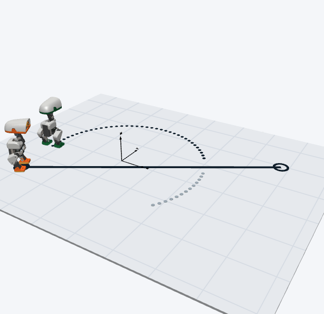

# MicroDuck

A Modelica plant library of the Pollen Robotics MicroDuck, a 25 cm biped with
14 servo-driven joints, verified against the MuJoCo model its walking policy
was trained in.



Component details and the blog series are on
[nouseng.co/libraries/atelier/microduck](https://www.nouseng.co/libraries/atelier/microduck/)
and [Why Rebuild a Walking Robot Duck in Modelica?](https://nouseng.co/libraries/atelier/microduck/why-modelica/).

## What it models

- `Robot`: complete 14-joint biped generated from the training MJCF file, with
  identical body masses, inertias, joint frames and sensor site frames
  (`frame_imu`, `frame_leftFoot`, `frame_rightFoot`, `frame_headCamera`,
  `frame_tof`, `frame_mouthTip`), plus an optional 15th mouth servo
  (`useMouth = true`).
- `Link` and `PositionServo`: each 3D revolute joint is driven through 2° of
  smoothed 1D gear backlash and mechanical joint-limit stops by an identified
  Dynamixel XL330 DC motor (`kT = 0.346 N·m/A`, `R = 2.50 Ω`, rotor inertia,
  Coulomb and viscous friction) with an optional two-node winding and housing
  thermal network (`useThermal = true`).
- `Battery`: optional two-cell NP-F550 lithium-ion pack (`useBattery = true`)
  built on the Modelica Standard Library cell stack, with state-of-charge
  open-circuit voltage and two RC polarization branches supplying all 14 servos.
- `PointContact`: eight contact points under each sole implementing MuJoCo's
  soft pyramidal contact and friction cone law, so a policy trained in MuJoCo
  meets the same ground compliance.
- `WalkingPolicy`: 50 Hz neural network walking policy (`velstand.onnx`
  weights embedded in C) with low-pass target filtering, the 22.5 ms training
  command delay and one-step delayed joint speed observation.

## Examples and verification tests

`MicroDuck.Examples` contains three runnable robot models:

- `Standing`: the robot dropped from 2.8 mm onto its soles with the servos
  holding the home pose at `positionGain = 800`, compared with MuJoCo.
- `WalkingTest`: the robot walking forward for 6 s at a 0.3 m/s command under
  `WalkingPolicy`, compared with MuJoCo.
- `NousLogo`: two MicroDuck robots walking simultaneously on the same floor to
  trace the circular arc and diagonal chord of the Nous logo.

`MicroDuckTest` contains four verification models with visible diagrams and
end-of-run `assert` checks against MuJoCo:

- `ForwardKinematicsCheck`: sets the 14 joints to a reference sample with the
  trunk fixed and checks the position and rotation matrix of all six sensor
  site frames against MuJoCo.
- `JointLimitTest`: drives three joints (`leftHipYaw`, `leftHipRoll` and
  `neckPitch`) past their upper mechanical limits and checks that each settles
  at its stop against MuJoCo.
- `DropTest`: drops a 0.8 kg mass from 50 mm onto one `PointContact` and checks
  the peak penetration and settled resting depth against MuJoCo.
- `SlideTest`: launches a 0.8 kg mass at 0.5 m/s across one `PointContact` with
  friction and checks the stopping distance against MuJoCo.

## Requirements

- OpenModelica 1.27.0, the version the library is checked with.
- Modelica Standard Library 4.1.0.

The release review environment is Windows. Linux and macOS have not been
verified.

## Installation

1. Install OpenModelica 1.27.0 and the Modelica Standard Library 4.1.0.
2. Clone the repository and change into this folder:

   ```sh
   git clone https://github.com/nouseng/libraries.git
   cd libraries/RoboticsAtelier/MicroDuck
   ```

3. In OMEdit, open `MicroDuck/package.mo` and `MicroDuckTest/package.mo`. From
   the command line:

   ```modelica
   loadModel(Modelica, {"4.1.0"});
   loadFile("MicroDuck/package.mo");
   loadFile("MicroDuckTest/package.mo");
   ```

## Getting started

Open `MicroDuck.Introduction` for an overview of the plant and components, then
`MicroDuck.GettingStarted` for a step-by-step setup of the standing robot.
Open `MicroDuck.Examples.WalkingTest` to run the closed-loop walk.

## Folder layout

| Folder | Contents |
| --- | --- |
| `MicroDuck/` | The `MicroDuck` Modelica library |
| `MicroDuckTest/` | Verification test models and check script |

## Tests

From this folder, with OpenModelica on `PATH`:

```powershell
omc MicroDuckTest/Resources/Scripts/CheckLibrary.mos
```

This checks all 16 classes in `MicroDuck` and all 5 classes in `MicroDuckTest`.

## Limitations

The optional mouth servo has its pivot and mass estimated from the meshes. Only
the soles collide with the ground. The randomized parts of reinforcement
learning training, such as varying command delay, sensor noise and per-episode
supply voltage, are replaced by fixed nominal values or exposed as parameters.

## Licence

Copyright (c) 2026 Vedat Senol and Ogulcan Isitman. Released under the BSD
3-Clause Licence; see [LICENSE](LICENSE). The MicroDuck CAD meshes and ONNX
policy weights originate from
[Pollen Robotics](https://github.com/pollen-robotics/microduck_rl) under
Apache-2.0.

## Citing

If you use the library in published work, please cite:

> Senol, V., & Isitman, O. (2026). *MicroDuck: a Modelica plant library for the
> Pollen Robotics MicroDuck biped* (Version 0.1.0) [Computer software].
> <https://github.com/nouseng/libraries/tree/main/RoboticsAtelier/MicroDuck>

## Consulting and contact

Need a multidomain plant model of your own robot, actuator and battery
calibration against hardware data or FMU integration into a training loop?
Nous Engineering & Research builds and validates physical plant models. Contact
Vedat Senol at [vedat@nouseng.co](mailto:vedat@nouseng.co) or Ogulcan Isitman at
[ogulcan@nouseng.co](mailto:ogulcan@nouseng.co).
